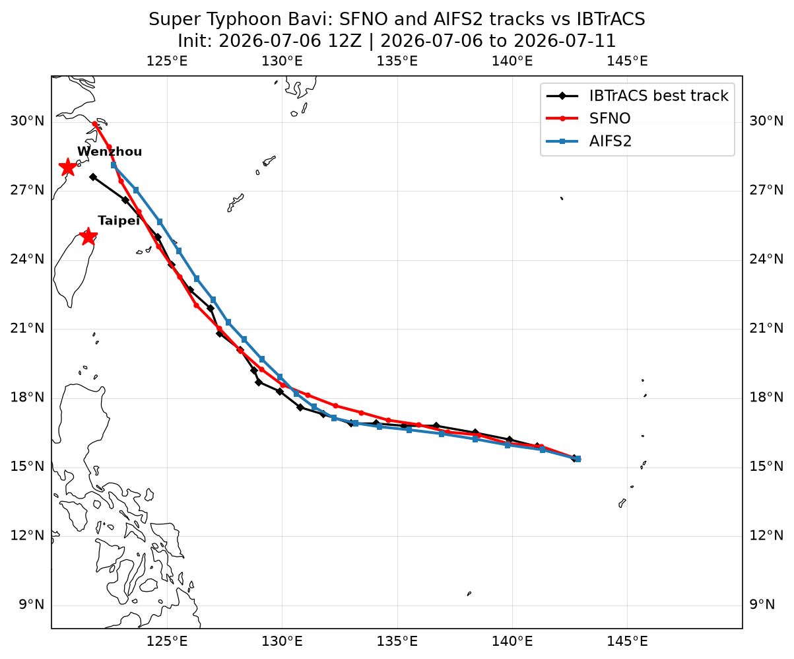
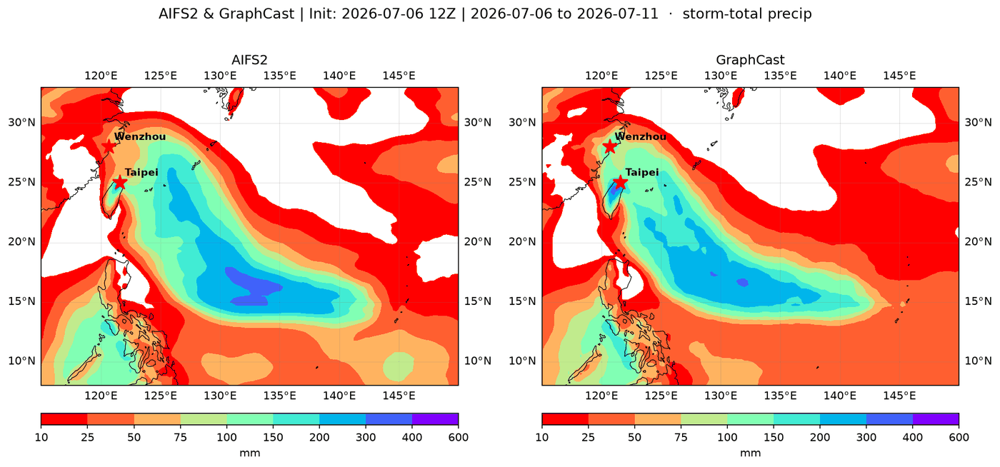

# Super Typhoon Bavi — AI Weather Model Forecast, July 2026



A 120-hour, 6-hourly forecast of Super Typhoon Bavi from the ECMWF IFS operational analysis of 2026-07-06 12 UTC, aimed at its expected landfall near Wenzhou, China (28.0°N, 120.7°E). NVIDIA's SFNO with the Wu–Duan cyclone tracker forecasts the storm's path and intensity, and ECMWF's AIFS2 and Google DeepMind's GraphCast forecast its rain and 10 m wind; the SFNO track is then verified against the IBTrACS best track. Everything runs with [NVIDIA Earth2Studio](https://github.com/NVIDIA/earth2studio).

## Results at a glance

The SFNO track (Wu–Duan tracker) is scored against the IBTrACS best track. IBTrACS positions and pressures are agency analyses, and the tracker defines the storm center differently, so some position error is definitional. Precipitation and wind from AIFS2 and GraphCast are shown as forecast products and are not scored. For 2026 storms IBTrACS still holds provisional tracks, which can change when the agencies release their final best tracks. The observed best track passes closest to Wenzhou after the forecast ends. So in the second table the forecast is compared with the best track inside the same forecast window ("Observed closest approach, forecast window (km)" and "Observed time, forecast window (UTC)"); "Observed time, full best track (UTC)" can only be read against "Last forecast fix (UTC)"; and "Timing error (h)" is reported as n/a when the forecast length censors it. Closest approach is read from 6-hourly positions, so a distance can be off by tens of kilometres and a time by up to 3 hours: IBTrACS's interpolated 3-hourly position at 15 UTC on 11 July is 41 km from Wenzhou, while the 6-hourly fix used here at 18 UTC is 83 km.

**Track and intensity error by lead time**

Lead 0 is the initial IFS analysis, not a forecast, so that row shows how closely the analysis agrees with the best track. Position error is the great-circle distance between the SFNO and IBTrACS storm centers. MSLP error is the SFNO minimum sea-level pressure minus the IBTrACS pressure, so a positive value means the model storm is too weak. Rows are every 12 h.

<!-- bavi_track_metrics:START -->
| Lead (h) | Position error (km) | MSLP error (hPa) |
|---|---|---|
| 0 | 18 | 24.2 |
| 12 | 21 | 21.9 |
| 24 | 61 | 24.6 |
| 36 | 56 | 29.2 |
| 48 | 69 | 19.1 |
| 60 | 34 | 5.3 |
| 72 | 117 | -2.1 |
| 84 | 174 | -8.7 |
| 96 | 253 | 0.4 |
| 108 | 315 | 13.9 |
| 120 | 258 | 25.8 |
<!-- bavi_track_metrics:END -->

**Closest approach to Wenzhou**

"Timing error (h)" is the forecast time of closest approach minus the observed time over the whole best track; a negative value means the forecast storm is closest earlier.

<!-- bavi_landfall_metrics:START -->
| Forecast closest approach (km) | Observed closest approach, forecast window (km) | Forecast time (UTC) | Observed time, forecast window (UTC) | Last forecast fix (UTC) | Observed closest approach, full best track (km) | Observed time, full best track (UTC) | Timing error (h) |
|---|---|---|---|---|---|---|---|
| 201 | 117 | 2026-07-11 06:00 | 2026-07-11 12:00 | 2026-07-11 12:00 | 83 | 2026-07-11 18:00 | -12 |
<!-- bavi_landfall_metrics:END -->


_Storm-total precipitation over the 120 h forecast, AIFS2 (left) and GraphCast (right): red is light rain, blue-purple is heavy rain._

The notebook also plots the SFNO intensity along the track, daily rain, and AIFS2 and GraphCast 10 m wind at the peak (the maximum over all lead times, including the initial analysis) and at the expected landfall time (2026-07-11 00 UTC, when the storm is still offshore).

## Models and data

| Model | Developer | Initial condition | Used for |
|---|---|---|---|
| SFNO | NVIDIA | ECMWF IFS operational analysis, 2026-07-06 12 UTC | Storm track and intensity (Wu–Duan tracker), scored against IBTrACS |
| AIFS2 | ECMWF | Same IFS analysis | Precipitation and 10 m wind; a second Wu–Duan track for comparison |
| GraphCast (operational) | Google DeepMind | Same IFS analysis | Precipitation and 10 m wind |
| IBTrACS | NOAA NCEI (agency best tracks) | — | Best-track truth for the SFNO track (position and minimum pressure) |

## Quick start

Requires Python 3.12, [uv](https://docs.astral.sh/uv/), and an NVIDIA GPU (developed and tested on an L40 with 48 GB; the table under *Notebooks* lists each notebook's peak GPU memory).

```bash
git clone https://github.com/ChristianByars/Bavi.git
cd Bavi
uv sync
uv run python -m ipykernel install --user --name bavi --display-name "bavi"
```

`uv sync` expects two prebuilt wheels (flash-attn and torch-harmonics) in a git-ignored `wheels/` folder at the repository root; see [docs/environment.md](docs/environment.md).

Open a notebook in JupyterLab and select the **bavi** kernel, then run all cells.

## Notebooks

<!-- RUNS:START -->
| Notebook | Runtime | Peak GPU memory (GiB) |
|---|---|---|
| bavi_forecast.ipynb | 8 min | 36.9 |
<!-- RUNS:END -->

| Notebook | What it does |
|---|---|
| `bavi_forecast.ipynb` | Runs SFNO with the Wu–Duan tracker, AIFS2 (wind and rain fields plus a second track) and GraphCast from one IFS analysis; maps daily and storm-total rain and 10 m wind; summarizes the forecast at Wenzhou; scores the SFNO track against IBTrACS and writes the two tables above to `docs/results/`. |

## Repository layout

```text
Bavi/
├── bavi_forecast.ipynb   # forecast and verification notebook
├── ibtracs.py            # IBTrACS best-track loader and track verification
├── metrics.py            # great-circle distance and forecast-skill metrics (NumPy only)
├── tests/                # pytest unit tests for metrics.py and ibtracs.py
├── docs/
│   ├── environment.md    # pinned versions, install caveats and fixes
│   ├── images/           # README figures
│   └── results/          # metric tables (CSV) written by the notebook
├── pyproject.toml        # dependencies (uv)
├── uv.lock               # exact tested versions
├── figures/              # the figures each notebook produces, at full size
└── outputs/bavi/         # Zarr forecasts, extracted tracks, cached IBTrACS file (git-ignored)
```

## Environment notes

Pinned versions, install caveats, and fixes are in [docs/environment.md](docs/environment.md).

## References

- [NVIDIA Earth2Studio](https://github.com/NVIDIA/earth2studio) and its [0.20.0 documentation](https://nvidia.github.io/earth2studio/0.20.0/), including the [cyclone-tracking example](https://nvidia.github.io/earth2studio/0.20.0/examples/02_medium_range/05_cyclone_tracking/) this notebook follows
- [IBTrACS](https://www.ncei.noaa.gov/products/international-best-track-archive): International Best Track Archive for Climate Stewardship (NOAA NCEI)
- Wu and Duan (2023), the tropical-cyclone detection method behind `TCTrackerWuDuan`: [doi:10.1016/j.wace.2023.100626](https://doi.org/10.1016/j.wace.2023.100626)
- [uv](https://docs.astral.sh/uv/), the Python package manager used for the environment
